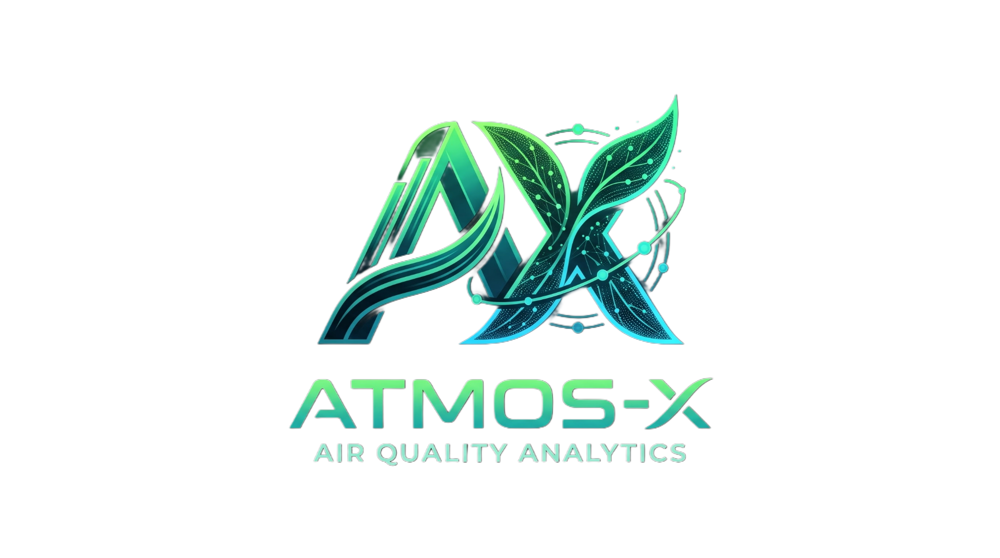
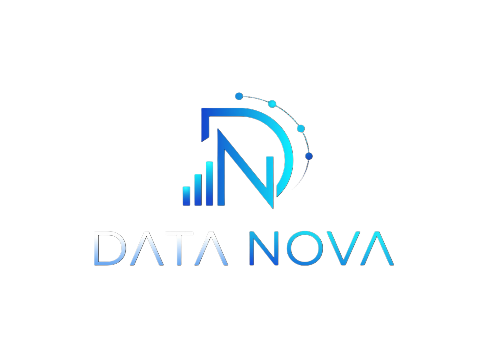
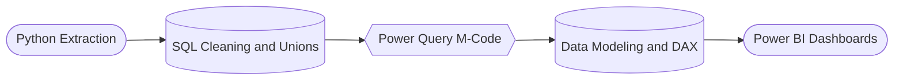

  <!-- لوجو Atmos-X الأساسي بحجم بارز

  <!-- لوجو Atmos-X الأساسي بحجم كبير وبارز -->
  <picture>
    <source media="(prefers-color-scheme: dark)" srcset="Atmos-X_Dark.png">
    <source media="(prefers-color-scheme: light)" srcset="Atmos-X_Dark.png">
    
  </picture>
  
  <!-- كلمة Powered by بحجم صغير جداً ومسافة رأسية ضيقة -->
  
<i>Powered by</i>

  
  <!-- لوجو DATA NOVA بحجم متوسط وواضح كختم فرعي -->
  <picture>
    <source media="(prefers-color-scheme: dark)" srcset="Logo-Dark.png">
    <source media="(prefers-color-scheme: light)" srcset="Logo-Light.png">
    
  </picture>

  

# Atmos-X: Egyptian Governorates Air Quality Analytics

## Project Name
Atmos-X (Powered by DATA NOVA Team)

## Project Idea
An end-to-end data analytics project aimed at monitoring and analyzing air quality and environmental metrics across various Egyptian governorates. The project provides actionable insights through interactive, dark-themed Glassmorphism dashboards, enabling users to track pollution levels, weather conditions, and climate trends effectively.

## 🔄 End-to-End Architecture & Pipeline

## 🛠️ Tools & Technologies Used

  
  
  
  

## Team Members
- Abdelrhman Mohamed Sharaf
- Ahmed Ekramy Elnaggar
- Mohamed Osama Roshdy
- Mostafa Mohamed Gaber
- Salah Al-Dien Ahmed Salah

## Work Plan
1. **Requirement Gathering & Domain Research:** Defining project scope, target audience, and key environmental problems.
2. **Data Collection:** Data extraction using Python.
3. **Data Pre-processing & Integration:** Cleaning and merging datasets using SQL and Power Query (M code).
4. **Data Modeling:** Creating relationships and a dedicated DAX Date table.
5. **Calculations & DAX:** Formulating required measures for environmental KPIs.
6. **UI/UX Design & Dashboarding:** Designing customized Glassmorphism / Dark UI templates and building final interactive dashboards in Excel and Power BI.

## Roles & Responsibilities
- **Abdelrhman Mohamed Sharaf (Data Engineer):** Data Collection via Python, Data Pre-processing, and Data Integration using SQL (Joins & Unions).
- **Ahmed Ekramy Elnaggar (Business / Research Analyst):** Domain Research, Identifying Environmental Problems & Solutions, Business Requirements Gathering, and Documentation.
- **Mohamed Osama Roshdy (BI Developer):** Data Collection via Python, Data Visualization, and Dashboard Development using Power BI.
- **Mostafa Mohamed Gaber (Quality Assurance / Research Analyst):** Domain Research, Data Validation, KPI Identification, and Assisting in Problem-Solving Strategies.
- **Salah Al-Dien Ahmed Salah (Team Leader & Junior Data Analyst):** Project Management, Workflow Verification, Data Pre-processing via Power Query (Excel & Power BI), Excel Executive Dashboard Design, and UI/UX Development.

## KPIs
- Average AQI (Air Quality Index)
- Average Temperature & Humidity
- Particulate Matter Levels (PM2.5 & PM10)
- Carbon Monoxide (CO) & Nitrogen Dioxide (NO2)
- Wind Speed and Atmospheric Pressure

## Instructor
Eng. Kareem Bakli

## Project Files
- `Atmos-X_Data.xlsx`: Cleaned dataset and Excel Executive Dashboard.
- `Atmos-X_Dashboard.pbix`: The final interactive Power BI analytical dashboard.
- `Background_Templates/`: UI/UX customized Glassmorphism background images.
- `Presentation.pdf`: Final project presentation slide deck.
